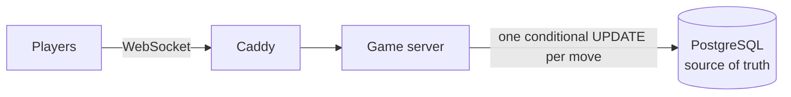

# Architecture

How Lights Out stays consistent and durable, and what changes when more than one game server handles the same rooms.



## The idea in three sentences

A room is one row in PostgreSQL holding its full state and a version number. A server never owns a room: to make a move it applies the rules to a copy and writes it back **only if the version has not changed**. Whoever loses that race re-reads and tries again, so there is exactly one order of events per room no matter how many servers are involved.

## Life of a move

1. A player taps. The browser sends `{"t":"act","a":"vote","v":"<player id>"}` over its WebSocket.
2. The server it happens to be connected to takes its cached copy of the room (or reads the row), clones it, and runs `act()` and `tick()` from `shared/engine.js`.
3. It writes: `UPDATE rooms SET state = …, version = version + 1 WHERE code = … AND version = <the version it started from>`.
4. **One row updated:** the move is committed and on disk. The server sends the new state to its own players.
   **Zero rows updated:** another server got there first. Wait a few random milliseconds, re-read, go to step 2.
5. Each server sends each player a personal message: the public state plus that player's secrets only.

Moves from one server to one room are queued, so collisions only happen between servers.

## Running several servers

There is no message bus. A server tells only its own players about a move. Players connected to a different server learn about it when that server's resync loop compares versions with PostgreSQL, which happens every 5 seconds.

So several servers stay **correct** (every guarantee below still holds, and the tests run with several servers) but not **snappy**: a table whose players are split across servers sees each other's moves up to 5 seconds late. Run one game server unless you accept that. One Node.js process holds tens of thousands of mostly idle game sockets.

To scale out without the lag, add a relay back. `server/bus/memory.js` shows the four-method interface (`subscribe`, `unsubscribe`, `publish`, `onMessage`) that `server/rooms.js` expects; a pub/sub service such as Valkey or NATS, or PostgreSQL `LISTEN/NOTIFY` at modest scale, can sit behind it.

## What is guaranteed, and the test that checks it

| Guarantee | How | Test (`test/`) |
| --- | --- | --- |
| No lost update, no double apply | Compare-and-set on `version`. Every action is idempotent. | `cluster`: "simultaneous actions from different servers" |
| One order of events per room | The row's version is the only clock. | `cluster`: "two servers, one room" |
| A timer fires once | Due rooms are leased with `FOR UPDATE SKIP LOCKED`, then committed with the same compare-and-set. | `cluster`: "timers fire exactly once", `store`: "leased to one sweeper" |
| A crash loses nothing | Servers hold only a cache. State is in PostgreSQL before any player is told. | `cluster`: "a server dies mid-game" |
| Players on another server catch up | Every 5 s each server compares versions with the store. | `cluster`: "a dropped broadcast is repaired" |
| Nobody is sent another player's secret | Views are built per player by `pubOf` / `privOf`. | `engine`: "five hundred random tables", `server`: "a full game over real sockets" |
| A finished game is archived exactly once | Archive row inserted in the same statement as the final state. | `store`: "archived with the final write" |

Run them against a real database with `TEST_DATABASE_URL` (see the README). The multi-server tests relay moves between test servers in memory, so they check correctness, not the 5-second delay.

## Durability

What is on disk, and when:

- **Room state:** in PostgreSQL's write-ahead log before the move is acknowledged to anyone. This relies on PostgreSQL's default `synchronous_commit = on`. Leave it on.
- **Finished games:** the `games` table, kept for `GAMES_RETENTION_DAYS`.
- **Nothing else.** Game servers can be destroyed at any moment.

To survive the loss of the database machine itself, run PostgreSQL with a standby. Patroni (MIT) manages failover, and `synchronous_standby_names` makes a commit wait for the standby so a failover cannot drop acknowledged moves. Take base backups with pgBackRest (MIT). None of that changes the application.

## When things fail

| Failure | What players see | What happens |
| --- | --- | --- |
| A game server crashes | "Reconnecting" until a server is back | Browsers keep retrying, then re-join with their token. The room continues from the row. Any timer the dead server had leased is picked up within 3 s of a server running again. |
| A deploy or `SIGTERM` | "Reconnecting" for a moment | The server tells clients to reconnect, then exits. They join the new server. Nobody is marked away. |
| PostgreSQL is down | Moves are refused ("server is busy"), sockets stay open | Nothing can be committed, so nothing is. Play resumes when it returns. |
| A player's connection drops | Others see them as "Away" | Their seat and role are kept. In a game, the table stops waiting for them and phase timers carry on. In the lobby the seat is freed after 20 s. |
| A phone sleeps mid-game | Same as above | On wake the page reconnects at once. |

## Timers

Phase deadlines, bot votes and lobby clean-up are data, not `setTimeout` calls. `nextDeadline(G)` computes the next moment a room needs attention and it is stored in `rooms.deadline_ms`. Every server runs a sweeper four times a second:

```sql
UPDATE rooms SET deadline_ms = now + 3000        -- lease it
WHERE code IN (SELECT code FROM rooms WHERE deadline_ms <= now
               ORDER BY deadline_ms LIMIT 200 FOR UPDATE SKIP LOCKED)
RETURNING code, version, state
```

The lease only hides the room from other sweepers for three seconds; it does not change the version. The sweeper then runs `tick()` and commits with the usual compare-and-set, which sets the real next deadline. If the server dies in between, the lease expires and another sweeper takes over. Deadlines are compared on the database's clock.

## Identity without accounts

- Each browser tab generates a random 128-bit **token** and keeps it in session storage. It is the seat ticket and is only ever sent to the server.
- The **player id** everyone sees is the first 8 hex characters of SHA-256(token). Knowing an id does not let you act as that player.
- Reload: the tab still has its token, so it returns to its seat.
- Tab closed and reopened: the new tab offers the previous token for that room (kept in local storage). The server hands the seat over only if that seat is currently away, so a second tab cannot take over a live one.

There is no way to recover a seat without the token. That is the price of no accounts.

## Secrecy

The server is the only place roles exist in full. `pubOf(G)` is what everyone gets; it includes a role only for dead players, and for everyone once the game ends. `privOf(G, id)` is what one player gets: their role, Mafia partners, the Detective's notes, and every card once they are a ghost. Night moves are never broadcast; others only see a count of how many have chosen.

A referee, if the host names one, is dealt no card and is the one exception: `privOf` sends the referee every card (`all`, one letter per seat, `R` for the referee), every night move as it is made (`na`) and the Detective's notes. The referee cannot pick or vote, cannot be picked or voted for, and does not count towards either side.

Serve the site over HTTPS (Caddy does this for a real domain) so roles are private on the network as well.

## Abuse limits

Per socket: 2 KB maximum message, 30-message burst then 8 per second, slow readers are dropped. Per address and server: `MAX_CONN_PER_IP` sockets and `CREATE_PER_MINUTE` new rooms. Names are stripped of control and markup characters and the client only ever inserts them as escaped text. Static files are served from a fixed list built at boot, so no request path can reach outside it.

These per-address limits are counted in each server's memory, so with N servers the effective limit is up to N times higher. That is acceptable for a party game; put stricter limits at the proxy if you need them.

## Wire protocol

JSON text frames on `/ws`.

Client to server:

| Message | Meaning |
| --- | --- |
| `{t:"create", token, name?, tint?}` | Open a room and sit in it. |
| `{t:"join", code, token, prev?, name?, tint?}` | Sit down, come back, or watch. `prev` is an earlier token for seat takeover. |
| `{t:"act", a, v?}` | A move. `a` is one of `rename tint addbot rembot kick referee disc start ready night vote callvote advance again`. `referee` (host, lobby) names a seated player as referee, or nobody with an empty value; `advance` (referee only) ends the current phase. |
| `{t:"leave"}` | Give up the seat. |
| `{t:"ping"}` | Heartbeat, every 20 s. |

Server to client:

| Message | Meaning |
| --- | --- |
| `{t:"joined", code, id, seat, adopted}` | `seat` is `in` or `watch`. |
| `{t:"state", v, now, pub, priv}` | The room at version `v`. `now` is the server clock, used to convert deadlines. |
| `{t:"err", e, a?}` | A refusal: `no_room`, `not_allowed`, `bad_target`, `too_few`, `slow_down`, `busy`, … |
| `{t:"pong", now}` / `{t:"bye"}` | Heartbeat reply / the server is restarting, reconnect. |

Clients treat `state` as the whole truth and simply render the highest version they have seen.

## Scaling, in the order you would do it

1. **One machine.** `docker compose up`. A room costs one small row and a few writes a minute.
2. **A bigger machine.** One game server process uses one CPU core, so give it a fast core and enough memory. PostgreSQL benefits from the remaining cores.
3. **Tune PostgreSQL.** More `shared_buffers`, fast disks, and PgBouncer (ISC) in front once you have many server processes, so connection count stays flat.
4. **Split the database.** Set `DATABASE_URLS` to several independent PostgreSQL servers. Each room lives entirely on one of them, chosen by a hash of its code, so capacity grows linearly. Changing the list re-maps codes, so do it when the site is quiet: rooms last minutes and the old ones simply expire.
5. **More game servers.** Only after adding a relay (see "Running several servers"); without one, tables split across servers lag by up to 5 seconds.
6. **Past that,** see "What would change this decision" in [STACK.md](STACK.md).

### Measured

On a 2-core, 8 GB sandbox running everything at once (PostgreSQL 16, the game server and the load generator itself), `scripts/loadtest.js` with eight scripted players per table:

| Setup | Tables | Sockets | Committed moves | Own move to state, p50 / p99 | Inconsistent tables |
| --- | --- | --- | --- | --- | --- |
| One server | 500 | 4,000 | 40,973 in 89 s | 6 ms / 26 ms | 0 |
| Two servers, every table split across both | 150 | 1,200 | 11,895 in 109 s | 6 ms / 33 ms | 0 |

The server used about 140 MB at 4,000 sockets. In the split run the servers caught up through the resync loop about 2,500 times; the latency column only measures how fast a player sees their own move, so it does not show that delay. Scripted players act the instant a phase opens, which real people do not, so write contention here (about one retry per five moves) is far above what a live table produces. These are numbers from a small shared box, not a capacity claim: measure on your own hardware with the same script.

## Known limits

- Presence after a crash: if a server dies, players who never come back stay marked present until their game ends. The game is not blocked (phase timers still fire), and in the lobby the host can remove them.
- Per-address rate limits are per server, not global.
- There is no admin interface. Operate it with SQL and the metrics endpoint.
- Several game servers lag each other by up to 5 seconds, as described above.
- The Compose file and Dockerfile describe the stack that was tested as plain processes (PostgreSQL 16, Caddy 2.6, Node.js 22). Build and run them once on your machine before relying on them.
